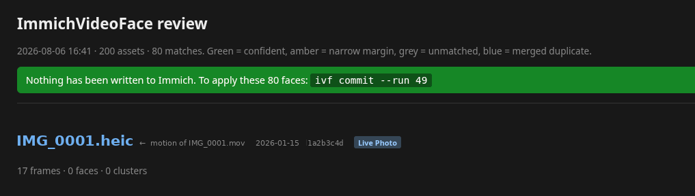
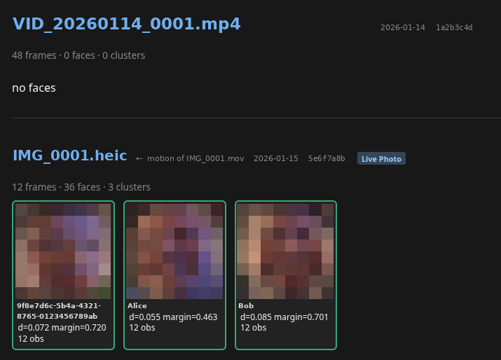
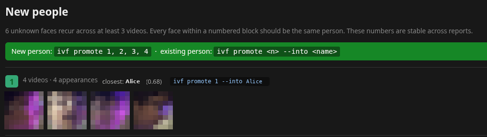

# ImmichVideoFace

> **This is a fork** of [CarlitoGrey/ImmichVideoFace](https://github.com/CarlitoGrey/ImmichVideoFace).
> It adds Immich 3.3+ support, CPU-only operation through Immich's own machine-learning
> service, installs without Docker, **when-is-who-on-screen** appearance times, and **object
> search over the whole video** (a sampled frame every 2 s by default, not only the thumbnail).
> See [What this fork adds](#what-this-fork-adds).

**Immich only looks for faces in a video's thumbnail.** If someone appears at 04:12 but not in
the frame Immich picked for the thumbnail, that video never shows up on their people page.

This tool scans the full duration of every video and writes the results back through Immich's
public REST API, so those videos appear natively under each person — same people page, same
search, no separate index to consult.

No Immich fork, no patched container, nothing added to the Immich stack.

> ## ⚠️ Back up your Immich database first
>
> **This is new software that has only been tested by its author, against one library.** It
> writes faces into your Immich database. Nothing here has been exercised on anyone else's
> setup, Immich version, or data.
>
> Every write is designed to be reversible with `ivf undo`, and the tool never modifies your
> media files or writes to the database directly. But "designed to be" is not the same as
> "proven across every setup", and a backup costs you a minute. Please read
> [Safety](#safety) and run `ivf parity` before pointing this at a library you care about.

---

## What this fork adds

| | Upstream | This fork |
|---|---|---|
| Immich versions | 2.x – 3.2 (`asset_face.personId`) | also **3.3+**, where faces point at person groups (`personGroupId`); detected automatically |
| Where faces are detected | InsightFace in-process, GPU strongly recommended | either that, or **`detect.backend = "immich-ml"`**: frames go to Immich's own ML service |
| Installs | Docker (`docker:` DB host, `/data` paths) | also native installs: Unix-socket Postgres, peer auth, host paths |
| Output | a face per person per video | also **appearance times** (who is on screen when) and **CLIP embeddings of sampled frames** (every `objects.interval_s`, 2 s by default) |

### Immich's ML service as the detector

`detect.backend = "immich-ml"` sends each sampled frame to the machine-learning service
Immich already runs (`POST /predict`, the same request Immich's server makes for a photo).

- **Same vector space by construction.** The embeddings come from the exact code and models
  that produced the reference gallery, so `ivf parity` lands near zero. Measured: median
  0.0008, worst 0.0055, the residue being JPEG re-encoding.
- **No GPU stack and no second copy of the models**, which matters on a small server.
- **`detect.ml_workers`** frames are kept in flight; the service runs them in parallel.
  On an 8-core VM without a GPU, 6 workers scanned phone video at 2 fps at about 3× real time,
  with faces and CLIP in the same request; the CPU default of one frame every 2 s is about 4×
  faster again.

### Appearance times and object search: the video index

With `[index] enabled = true`, results also go into a Postgres schema that the tool's own
database role owns. Immich's tables are still never written directly.

| Table | What it holds | When it is written |
|---|---|---|
| `ivf.appearance` | per video and person: `[[start_ms, end_ms], …]` on screen, plus the face id carrying the person on the asset | on `commit` / `promote`; removed by `undo` |
| `ivf.frame_embedding` | a CLIP vector every `objects.interval_s` of video | at `scan` time: these only change what search can find, so no review |
| `ivf.video` | what was indexed, with which settings | at `scan` time |

- **Appearance times.** Detections are grouped per person as before, and each group's
  sighting times become intervals. An absence longer than `timeline.gap_s` (3 s) starts a
  new appearance; shorter misses, like a turned head or motion blur, are bridged.
- **Objects.** With `[objects] enabled = true`, every `interval_s`-th sampled frame also asks
  the ML service for a CLIP embedding, in the same request as faces. `objects.model` must
  equal Immich's smart search model; `ivf check` compares them and `ivf scan` refuses on a
  mismatch, as for faces.
- **Live Photo motion clips** contribute faces to the still, as upstream, but no frame
  embeddings or timeline, since the clip itself is hidden.

Stock Immich ignores the `ivf` schema. A build with the companion patch reads it:

- **The video viewer** shows a timeline with a row per person, marking when they are on screen.
- **Smart search** ranks a video by its best-matching sampled frame, not just its thumbnail.
  Something on screen for less than the sampling interval can be missed; lower
  `objects.interval_s` to trade scan time for coverage.

The patch is in [`immich-patch/`](immich-patch/), one directory per Immich release it was
made for. Nothing else here needs it.

### Running without Docker

```toml
[paths]
data_root_container = "/var/lib/immich/library"   # Immich stores host paths:
data_root_host      = "/var/lib/immich/library"   # map them to themselves

[db]
host = "/run/postgresql"   # a socket directory works; password may be blank for peer auth
user = "ivf"
```

A dedicated read-only role, plus the index schema, set up once as a Postgres superuser:

```sql
CREATE ROLE ivf LOGIN;
GRANT CONNECT ON DATABASE immich TO ivf;
GRANT USAGE ON SCHEMA public TO ivf;
GRANT SELECT ON asset, asset_face, asset_file, asset_exif, person, person_group, face_search TO ivf;
-- only with [index] enabled:
CREATE SCHEMA ivf AUTHORIZATION ivf;
GRANT USAGE ON SCHEMA ivf TO immich;   -- the role Immich connects as
ALTER DEFAULT PRIVILEGES FOR ROLE ivf IN SCHEMA ivf GRANT SELECT ON TABLES TO immich;
```

Use Immich's bundled ffmpeg, if it has one, so every codec Immich plays can be decoded:
put its directory first on `PATH` (for example `/opt/immich/current/runtime/bin`).
`person_group` only exists from Immich 3.3; leave it out of the grant on older versions.

---

## How it works

```
videos (POST /search/metadata, or straight from the database)
  → read the file directly off the library volume
  → ffmpeg: keyframes + a frame-rate floor, raw BGR piped into Python
  → InsightFace buffalo_l on the GPU: detect and embed every face
  → cluster the observations within the video (one cluster per appearance)
  → match each cluster against Immich's own stored face embeddings
  → stage the result → you review an HTML report → commit
```

Three design decisions carry most of the accuracy.

**Cluster before matching.** Matching each frame independently is noisy — one blurry frame can
pull a false identity. Clustering an appearance across dozens of frames and matching the
blur-weighted centroid is far more robust, and cuts matching work by roughly two orders of
magnitude.

**Read Immich's real embeddings.** Immich stores every labelled face as a 512-dimension vector
in its `face_search` table. This tool reads those directly (read-only) rather than re-deriving
them from person thumbnails, so matching happens in exactly the vector space Immich already
uses. Every *write* still goes through the REST API.

**Two gates, not one.** A match needs both a low absolute distance and a clear lead over the
runner-up. On real data the lead separates cases far more sharply than distance alone: correct
matches led by 0.27–0.34, while near-misses led by under 0.02 at similar absolute distances.

---

## Requirements

- Immich v2 or v3 (including 3.3+), with the library volume readable and Postgres reachable
- Python 3.11+ (3.12 recommended; 3.13 tested with the immich-ml backend)
- ffmpeg and ffprobe
- With the default `insightface` backend, an NVIDIA GPU is strongly recommended — CPU works
  but is roughly 20× slower. The `immich-ml` backend needs neither a GPU nor InsightFace.

It expects to run on the machine hosting Immich, or anywhere the library volume is mounted and
the database is reachable.

### Your model must match Immich's

This is the one piece of configuration that will silently ruin results if you get it wrong.

Every embedding in Immich's `face_search` table was produced by whichever recognition model
Immich is configured with (**Administration → Settings → Machine Learning → Facial
Recognition**; `buffalo_l` by default, but `buffalo_s`, `buffalo_m` and `antelopev2` are also
offered). A different model produces a **different vector space of the same 512 dimensions**,
so distances remain plausible-looking numbers — the tool would confidently match the wrong
people rather than failing visibly.

`detect.model` in `config.toml` must therefore equal Immich's setting. Two guards enforce it:

- `ivf check` reads Immich's configured model and compares
- `ivf scan` refuses to run on a mismatch, naming the value to set

If your API key lacks admin rights the setting can't be read, and the tool says so — in that
case `ivf parity` is your check: mismatched models produce distances nowhere near zero.

## Install

```bash
git clone https://github.com/DigitalCyberSoft/ImmichVideoFace.git
cd ImmichVideoFace
uv venv --python 3.12
uv pip install -e ".[cuda]"      # drop [cuda] for CPU-only
cp config.toml.example config.toml

# immich-ml backend only (no InsightFace / onnxruntime):
uv pip install --no-deps -e . && uv pip install httpx "psycopg[binary,pool]" numpy pydantic \
    typer rich opencv-python-headless scikit-learn
```

The `cuda` extra pulls the NVIDIA runtime libraries as wheels, so no system CUDA install is
needed. If onnxruntime silently falls back to CPU, the tool warns rather than quietly running
20× slower.

Create an Immich API key (Account Settings → API Keys) with:

```
asset.read, face.create, face.read, face.delete,
person.read, person.create, tag.create, tag.asset
```

This fork also uses `asset.view` (preview images), `asset.update` (required by Immich 3.3 to
add a face), `person.delete` and `person.statistics` (undo), `user.read`, and
`systemConfig.read` (the face and search model checks).

Secrets are better passed as environment variables than written to the config file:

```bash
export IMMICH_API_KEY=...
export IMMICH_DB_PASSWORD=...
```

### Reaching Postgres

Immich does not publish Postgres to the host, so `db.host` defaults to
`docker:immich_postgres`, which resolves the container's bridge IP at startup. That address
changes when the container restarts, so don't hard-code it.

### Path mapping

Immich stores container-absolute paths (`/data/library/...`). Set `paths.data_root_host` to
wherever that volume actually lives on the machine running this tool.

---

## Usage

Scanning and writing are deliberately separate, with a human in between:

```
ivf scan --limit 50  →  reports/run-N.html  →  you look  →  ivf commit --run N
                                             ↘  ivf promote 1 4 6
```

Work in batches. Commit a batch and the next scan moves on; skip it and the next scan shows you
the same videos again:

```bash
ivf scan --limit 50            # stage the next 50 videos, write nothing
# open reports/run-N.html
ivf commit --run N             # apply the matches
ivf promote 1 4 6              # create people for those numbered groups
```

Everything else:

```bash
ivf check          # config, API, database schema, gallery size
ivf parity         # prove embeddings match Immich's — run this first
ivf scan --newest  # most recent videos rather than oldest
ivf promote        # list candidates with the closest known person for each
ivf duplicates     # people Immich has split into several records
ivf undo --run N   # remove everything a commit or promote created
ivf status         # progress, and whether staged runs are still valid
```

### The review report

`scan` never touches Immich. It stages matches locally and renders an HTML page: face crops
beside the person matched, colour-coded by confidence, each video linked directly to its asset
in Immich. Numbered new-person candidates appear at the bottom.

The header states the run number and exactly what would be written, and nothing has been:



Each asset lists its clusters, the person matched, the distance and the margin over the
runner-up, so a borderline call is visible rather than buried:



*Faces, names and asset identifiers in these screenshots are redacted.*

The report is a sense check, not an editor. If something looks wrong, adjust thresholds and
re-scan rather than hand-editing.

**The newest report is the only one that matters.** Exactly one batch is ever outstanding:
starting a new `ivf scan` abandons any uncommitted batch and puts those videos back in the
queue, so the next report covers them again. Commit a batch and the queue moves on; skip it and
you simply get another look at the same videos.

That keeps the whole model to one rule — *act on the report you just generated* — and removes
any question about which run to commit or which promote numbers are current.

### Unknown faces

Scans never create people. They *bank* unmatched clusters locally, then group everything banked
so far **across videos**. A group must span at least `promote_min_assets` distinct videos before
it is even offered — a stranger in one clip stays noise, someone recurring becomes a person
worth naming.

Each candidate is shown with the **closest known person**, because a group that missed the
matching threshold is usually somebody already in your library rather than a stranger:



The same listing in the terminal:

```
 # │ Videos │ Appearances │ Closest known person │ Distance
 1 │      5 │          14 │ John                 │    0.422
 2 │      4 │           7 │ Roger                │    0.381
 6 │      3 │           6 │ (unnamed) 585e9893   │    0.809
```

So you can either create a new person, or attach the group to the person it obviously is:

```bash
ivf promote 1 4              # create a new person for each
ivf promote 1 --into John    # attach group 1 to the existing John
```

**Promote from the report you just generated.** Numbers are anchored to a group's
earliest-banked member, so they mostly persist — but promoting a group removes its faces from
the pool, and the remaining faces can regroup slightly differently. Nothing can guarantee a
number survives that, so the rule is the same as for batches: the newest listing wins. `ivf
promote` with no arguments reprints the current set, and a number that doesn't exist is
refused rather than guessed.

### Live Photos

The motion clip behind a Live Photo is a **hidden** asset in Immich: it never appears on a
people page, so a face written there is invisible. The still image beside it is what Immich
displays, and Immich already detects faces on that.

These are not a rounding error. In one library they were **46% of all videos**, and scanning
them accounted for 89% of everything written — of which 93% simply duplicated a person already
detected on the paired still.

`select.live_photos` controls this, defaulting to `redirect`: the clip is scanned, but any face
found is written onto the **still**. Anyone already detected there is skipped as a duplicate, so
the only writes produced are people who appear *in the motion but not the still* — which is
exactly the gap worth filling. Set it to `skip` to ignore these clips entirely.

---

## Safety

This writes into your photo library. The design assumes that matters.

- **Nothing is written without review.** `scan` stages; `commit` applies.
- **Everything is reversible.** `ivf undo --run N` removes every face, person and tag a run
  created. `POST /api/faces` returns no body, so each write is logged locally as
  (asset, person, bounding box) and matched back on undo.
- **Writes are idempotent.** Re-committing skips anyone already attached, re-checked at commit
  time rather than scan time.
- **The database is read-only.** The connection is opened read-only; every mutation goes
  through the REST API.
- **Stale work is refused.** Staged runs record a fingerprint of every setting that affects
  results — selection, sampling, detection, clustering and matching. Change any of them and
  `commit` stops rather than writing results your current configuration wouldn't produce.
  `ivf status` shows which staged runs are affected.
- **One bad row can't abort a batch.** If a person was merged away in Immich, that face is
  skipped and stays staged; the rest proceed.

### Verify before trusting it

**`ivf parity` is the gate that matters.** It pulls known faces from `face_search`, re-runs
detection and embedding over the same preview image Immich used, and reports cosine distance.
Near zero means this tool lands in Immich's vector space. If it doesn't, every downstream match
is meaningless — fix that before anything else.

On a correctly configured system it looks like this:

```
Person    IoU    Cosine distance   Verdict
Alice     1.00            0.0000   match
Bob       0.99            0.0001   match
...
median distance 0.0000, worst 0.0001
PASS - our embeddings share Immich's vector space.
```

Then dry-run a video where you know who appears, tune `match.max_distance`, and commit a single
asset before any bulk run.

---

## Tuning

Defaults are tuned for precision over recall: a wrong face on someone's page is worse than a
missed one. The settings below are the ones that actually matter, and every one of them was
changed in response to a real failure.

### `cluster.distance` — the one most likely to bite you

Tightening it loses people rather than gaining precision. Two views of the *same* face across a
video — different angle, motion blur, changing light — routinely sit further apart than 0.35.
At that threshold, one 92-second clip produced **192 clusters from 246 detections**: a single
person split across four clusters, which `min_observations` then discarded. Someone plainly
on screen, whom Immich itself had found, was missed entirely. At 0.55 they were recovered.
Immich's own recognition threshold is 0.5, which is the right neighbourhood.

**Symptom to watch for:** a cluster count close to the detection count.

### `sampling.min_fps` — decides whether brief appearances survive

> **This fork:** `min_fps = "auto"` (the default) samples at `gpu_fps` (8) when detection runs
> on a GPU and at `cpu_fps` (0.5, one frame every 2 s) when it does not. On a GPU decoding
> dominates, so 8 fps is nearly free; on CPU every frame is a full detection pass, and 8 fps
> would take about 16× longer than 0.5. `cluster.min_observations` and `timeline.gap_s` follow
> the chosen rate when left at `"auto"` (1 sighting and 5 s at 0.5 fps; 3 and 3 s at 8 fps).
> `detect.gpu` overrides the GPU guess, and `ivf check` shows what was chosen.

A person on screen for three seconds yields three observations at 1 fps, and if clustering
splits them at all, `min_observations` discards the lot. On a wedding clip, a man whose
individual frames matched at 0.35 vanished entirely at 1 fps and appeared correctly at 2 fps.

Raising this doesn't loosen any threshold — it gives short appearances enough evidence to clear
the bar. **It is also much cheaper than it looks**: decode dominates runtime, not frame count.
Measured on one library, 8 fps cost only ~11% more wall time than 1 fps.

### `detect.min_face_px` — tiny faces are actively harmful

ArcFace aligns to 112×112, so a 20-pixel face is upscaled guesswork whose embedding is mostly
noise. Those vectors don't merely fail to match — they fragment clustering and drag centroids
around. On one clip, 158 of 246 detections were under 60px; discarding everything under 40px
cut cluster count by 2–4× and cost no matches at all.

It also removes a class of bad write: matches derived from 17–22 pixel faces, which were the
least trustworthy in the entire set.

### `match.probe_observations` — a centroid alone loses evidence

Averaging every view across a long clip mixes clean frontal frames with profile and blurred
ones. Real case: individual frames of the same person matched at 0.29–0.35 while the cluster
centroid landed at 0.46 and was rejected. This scores the sharpest few observations
individually as well, keeping whichever result is closest.

### `match.prefer_named_within` — works around fragmented libraries

Immich commonly holds one person as both a curated name and several unnamed clusters it never
merged. Without this, a video attaches to whichever is marginally nearer — often the unnamed
one — so it never appears under the name you actually use. When an unnamed cluster and a named
person are within this distance of each other, the name wins.

If you see a lot of this, `ivf duplicates` lists the split records. Merging them inside Immich
is the real fix: it improves matching for everything, since it deepens the reference gallery.

---

## How Immich behaves, and why it matters

Findings from reading Immich's source that shape this tool:

| Behaviour | Consequence |
|---|---|
| `POST /api/faces` stores `sourceType: Manual` and performs no inference | Written faces get no embedding, so they can never feed back into the reference gallery and cause drift |
| The recognition job skips faces whose source isn't `machine-learning` | Immich never re-clusters or reassigns these writes — they're stable |
| `createFace` calls `createNewFeaturePhoto` when a person has no feature photo | The first face written for a *new* person becomes their avatar, cropped from the video's **thumbnail** frame |
| `AssetMetadataKey` is a locked enum | `PUT /assets/{id}/metadata` can't hold processing state; it lives in SQLite instead |
| `createFace` returns no body | Undo only works because each write is recorded locally |

That third row is why `promote` detects faces on each candidate's preview image and leads with
one where the person is actually visible there — otherwise every new person gets an avatar of
whatever happened to be at those coordinates in the thumbnail.

**A note on bounding boxes.** A face detected at 04:12 is written with coordinates from that
frame, but Immich renders face crops from the asset's thumbnail. The video correctly appears
under the person; the small crop beside it is whatever was at those coordinates in the
thumbnail. Cosmetic, and unavoidable without Immich storing per-timestamp faces.

---

## Limitations

- **Matching depth is limited by your library.** Someone with three reference photos is an
  unreliable target no matter the settings. This works best for people with a deep gallery.
- **Immich isn't doing the same job.** When Immich "finds" a thin cluster on a video it is
  *creating* that identity from that very face. This tool recognises against an existing
  gallery, which is harder. Comparisons against Immich as ground truth understate that.
- **The database schema is an internal Immich detail.** A startup assertion fails loudly and
  specifically on mismatch rather than returning wrong data, but an Immich upgrade may require
  updating `REQUIRED_SCHEMA`.
- **Single-owner.** Multi-user libraries are untested.
- **Tested against one library, one Immich version, one GPU.** Immich 3.0.3, ~9,500 videos,
  an RTX 4090. Other versions and setups are unexercised.
- **Changing a model or threshold invalidates prior scans.** That's deliberate — the
  fingerprint covers everything affecting results — but it does mean re-scanning.

## Configuration reference

See [`config.toml.example`](config.toml.example) — every setting is commented.

## Licence

MIT — see [LICENSE](LICENSE).

Face detection and recognition use [InsightFace](https://github.com/deepinsight/insightface),
whose models are licensed for non-commercial research use. This project is not affiliated with
the Immich project.
